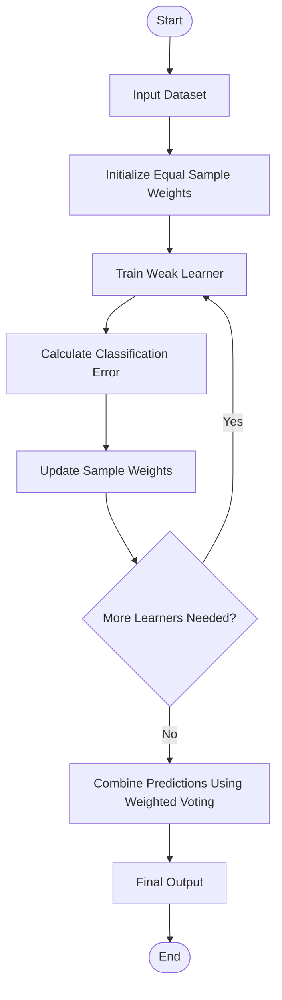
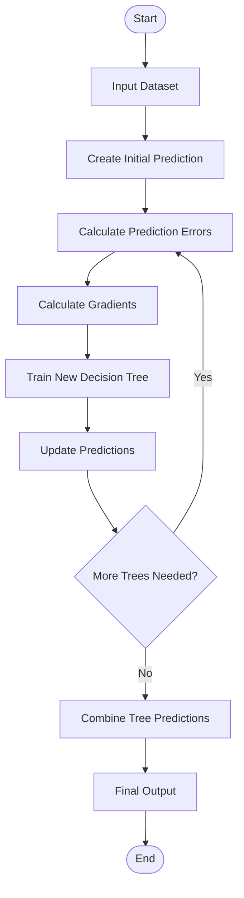
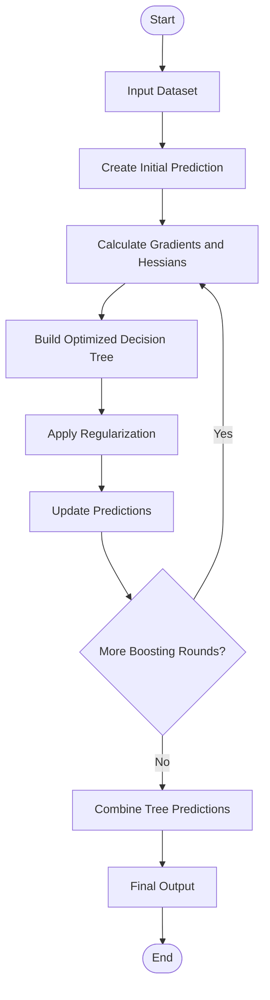

# AdaBoost, Gradient Boosting & XGBoost

## Overview
This project demonstrates and compares three popular boosting algorithms used in Machine Learning:

- AdaBoost
- Gradient Boosting
- XGBoost

The Iris dataset is used to train and evaluate the models. Their performance is compared using Accuracy, Precision, Recall, and F1 Score.

---

## 1. AdaBoost (Adaptive Boosting)

**Definition:** AdaBoost is a boosting algorithm that improves model performance by giving more importance to incorrectly classified samples.

### Workflow

### Steps
1. Input the training dataset.
2. Assign equal weights to all samples.
3. Train a weak learner.
4. Calculate classification errors.
5. Increase weights of misclassified samples.
6. Repeat the process with new weak learners.
7. Combine predictions using weighted voting.
8. Generate the final output.

**Key Point:** AdaBoost focuses on incorrectly classified samples.

---

## 2. Gradient Boosting

**Definition:** Gradient Boosting is an ensemble learning algorithm that builds decision trees sequentially to reduce prediction errors.

### Workflow

### Steps
1. Input the training dataset.
2. Create an initial prediction.
3. Calculate prediction errors using a loss function.
4. Calculate gradients to determine how to reduce the loss.
5. Train a new decision tree to predict corrections.
6. Update predictions using the learning rate.
7. Repeat the process until the required number of trees is reached.
8. Combine all tree predictions to generate the final output.

**Key Point:** Gradient Boosting focuses on reducing prediction errors using gradients.

---

## 3. XGBoost (Extreme Gradient Boosting)

**Definition:** XGBoost is an optimized implementation of Gradient Boosting that uses regularization and efficient computation to improve model performance.

### Workflow

### Steps
1. Input the training dataset.
2. Generate initial predictions.
3. Calculate gradients and Hessians.
4. Build decision trees using gradient and Hessian information.
5. Apply regularization to control overfitting.
6. Update predictions using the new tree.
7. Repeat until the specified number of boosting rounds is completed.
8. Combine all tree predictions to generate the final output.

**Key Point:** XGBoost uses gradients, Hessians, regularization, and optimization techniques.

---

## 4. Comparison of Boosting Algorithms

| Feature | AdaBoost | Gradient Boosting | XGBoost |
|---|---|---|---|
| Full Form | Adaptive Boosting | Gradient Boosting | Extreme Gradient Boosting |
| Main Idea | Updates sample weights | Reduces prediction errors | Optimized gradient boosting |
| Error Handling | Sample weights | Gradients | Gradients and Hessians |
| Base Learner | Weak classifiers | Decision trees | Optimized decision trees |
| Regularization | Limited | Available | Built-in |
| Learning | Sequential | Sequential | Sequential |

---

## 5. Dataset Used

**Iris Dataset**

The Iris dataset contains 150 flower samples belonging to three classes:

- Setosa
- Versicolor
- Virginica

**Input Features:**
- Sepal Length
- Sepal Width
- Petal Length
- Petal Width

**Dataset Splitting:**
- 80% Training Data
- 20% Testing Data

---

## 6. Model Evaluation

The three algorithms are evaluated using the following performance metrics:

| Metric | Purpose |
|---|---|
| Accuracy | Measures overall correct predictions |
| Precision | Measures correctness of positive predictions |
| Recall | Measures correctly identified actual samples |
| F1 Score | Combines Precision and Recall |

---

## 7. Technologies Used

- Python
- Scikit-learn
- XGBoost
- NumPy
- Machine Learning

---

## 8. Conclusion

AdaBoost, Gradient Boosting, and XGBoost are ensemble learning algorithms that combine multiple weak learners to create a stronger model.

This practical helps understand their working processes and compare their performance using different evaluation metrics on the Iris dataset.